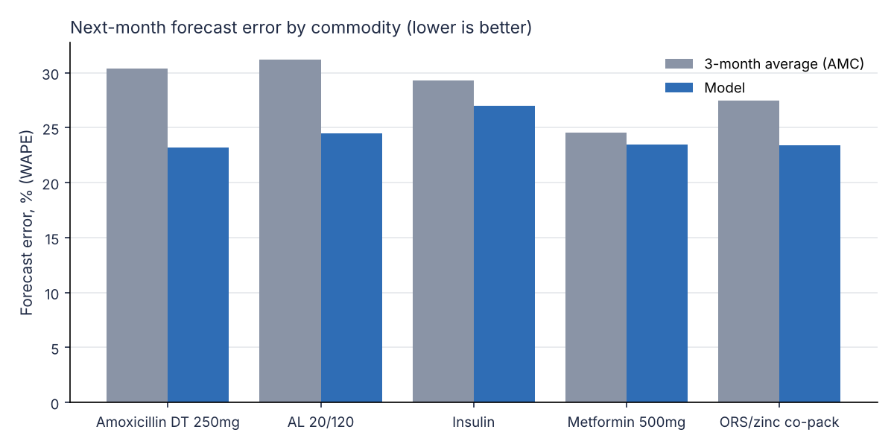
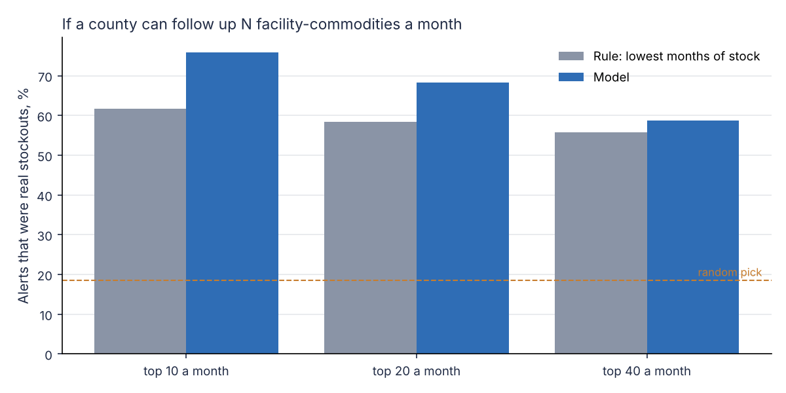

# Stockout early warning for essential medicines

A prototype that helps a county pharmacist in Kenya decide, each month, which facilities to follow up before they run out of a medicine, and where stock can be moved from a facility that has too much, before it expires.

I built this because I've spent years on the other side of the problem. At Novo Nordisk, 200,000 vials of insulin at KEMSA were close to expiring while facilities were short. We used KEMSA's own stock movement data to redistribute them, and the account went on to order another 300,000. That was done by hand, with spreadsheets and phone calls. This project asks how much of it a simple, explainable model could do every month.

**[Open the live demo](https://hazeldaislyz-cloud.github.io/stockout-early-warning/)**: a map of the six counties, the month's follow-up list, the suggested transfers and each county's brief, in the browser. No installation needed.

> **The facility data is simulated, but calibrated against real records.** Facility-level stock data in Kenya is not public, so `simulate.py` generates monthly reports with the same fields as a real LMIS return. Its supply side (how often facilities are resupplied, in what quantities, with how much shelf life left) is tuned to match about 1,500 real national warehouse issue records for insulin. Those records are confidential and are not in this repository. The results below show the method works on realistic data. They are not evidence about any real county.

## What it does

1. **Forecasts next month's consumption** for each facility and medicine, and compares it with the method most facilities use today: the average of the last three months (AMC).
2. **Scores the risk of a stockout next month**, and compares it with the usual rule of following up facilities with the fewest months of stock first.
3. **Suggests transfers** between facilities in the same county: from facilities with short-dated or surplus stock to nearby facilities at high risk.
4. **Writes a one-page brief per county** in plain language. If an Anthropic API key is set, a language model writes it; every number it uses is then checked against the model outputs, and the brief is replaced with a plain template if any number doesn't match.

## The simulated data

- 48 facilities in 6 counties (Nairobi, Mombasa, Kisumu, Kakamega, Nakuru, Turkana): a county referral hospital, health centres and dispensaries in each.
- 5 tracer medicines: insulin (premixed 30/70), metformin, artemether-lumefantrine (AL), amoxicillin DT and ORS/zinc.
- 36 months, January 2023 to December 2025.
- Each report has the fields a facility submits: opening balance, received, dispensed, expired, closing balance and days out of stock.

It builds in the problems real data has:

- lumpy resupply: facilities order about once a quarter, and top up early only when they're nearly out
- orders filled only in part, issued in whole packs, and sometimes a month late
- county-wide supply shocks lasting one to three months
- "push" deliveries of short-dated stock that nobody ordered
- stock arriving with only about half its shelf life left, then dispensed first-expiry-first-out
- very uneven facility sizes: a referral hospital uses about 20 times what a dispensary does
- seasonal demand (malaria peaks after the rains, strongest around Lake Victoria), and a milder pattern for chronic medicines, with a dip in December
- about 6% of monthly reports never submitted

One detail matters a lot: **in a month when a facility ran out, what it dispensed is less than what patients needed.** Those months are left out of the forecasting target, so the model doesn't learn to expect low demand from facilities that simply had nothing to give.

## How the simulation was calibrated

My first version of the simulation resupplied facilities almost every month, in small, exact quantities, with plenty of shelf life left. Real records don't look like that. I checked it privately against about 1,500 lines of real national warehouse issue records for insulin (2020 to 2025), then changed the simulation to match. `calibration_check.py` prints the comparison:

| Measure | Real records | Calibrated simulation | First version |
|---|---|---|---|
| Months between orders, for facilities that order more than once (median) | 3 | 3 | 1 |
| Share of months a facility receives stock (median) | 12–14%* | 29% | 71% |
| Quantities issued in whole packs of 10 | 98% | 100% | 8% |
| Shelf life left on arrival, insulin (median) | 13 months | 14 months | 14–21 months |
| Largest facility vs median facility, insulin | 30–98x | 31x | 5x |
| Month-to-month swing in national insulin deliveries (CV) | 0.43–0.46 | 0.61 | 0.32 |

\* From the national warehouse alone. Facilities also buy from faith-based and private suppliers, so the true figure is higher.

The simulation sits at the low end of the real range for how uneven facilities are, and its national deliveries swing a little more than real ones, because 48 facilities is a small total.

## Results

All evaluation is out of time. The model is only ever trained on months before the ones it's tested on.

### Forecasting next month's consumption

Rolling backtest over 12 months, 2,134 forecasts. WAPE is total absolute error divided by total actual consumption.

| Method | Forecast error (WAPE) |
|---|---|
| 3-month average (current practice) | 29.1% |
| Gradient-boosted model | 24.0% |

The gain is largest for seasonal medicines (amoxicillin 30.4% to 23.2%, AL 31.2% to 24.5%), because the model learns the seasons and the 3-month average always lags behind them (see `outputs/example_forecast.png`). For insulin (29.3% to 27.0%) and metformin (24.5% to 23.5%) the gain is small.



**A check on real data, and it's a sobering one.** I also ran the same kind of test on a confidential real series: monthly distributor sales of 22 chronic-disease medicines, 2015 to 2026, forecasting each month from January 2023 to July 2026 (935 forecasts). There the model and the 3-month average tied: 30.0% against 29.6%. That data is at distributor level, not facility level, and the model had only past sales to go on. Still, it's a warning. Most of the model's forecasting edge in the simulation comes from seasonal medicines. For steady chronic medicines on real data, the 3-month average is hard to beat, and I'd only claim a forecasting gain after testing on real facility data.

### Which facilities to follow up

Test period: 12 months, 2,621 facility-medicine checks, 487 of which ran out the following month (19%).

A county team can only follow up so many facilities. So the question is: **if you follow up the top N each month, how many of them were really about to run out?**

| Ranking method | PR-AUC | Top 10 a month | Top 20 a month | Top 40 a month |
|---|---|---|---|---|
| Rule: fewest months of stock first | 0.53 | 62% | 58% | 56% |
| Model (7 features, shallow trees) | 0.63 | 76% | 68% | 59% |
| Model I tried first (17 features) | 0.61 | 72% | 66% | 58% |



**Why the model helps more once supply is lumpy.** When deliveries come once a quarter, stock falls in a saw-tooth. Months of stock on its own can't tell a facility whose delivery is due next week from one whose order was never placed. The model adds what the rule ignores: how much the facility received recently, whether deliveries to the whole county have been short this month (a sign of trouble upstream), and the forecast, which knows when the season is turning. On the first, too-smooth version of the simulation, the model's edge on the top-20 list was 9 points (55% against 46%). On the calibrated version it's 10 points, and it holds at every list size.

**What didn't work.** My first model used 17 features. On the first version of the simulation it did *worse* than the simple rule, because it overfit: it learned patterns from the early months that didn't hold later. Cutting it to 7 features a supply officer would recognise, and restricting the trees, fixed that. On the calibrated simulation the 17-feature model beats the rule, but it still trails the 7-feature model in all six test datasets. The smaller model is the better choice either way: it's more accurate and easier to explain.

**Is it robust?** `robustness.py` re-runs everything on six different simulated datasets:

- Forecasting: the model beat the 3-month average in all six, by 5.1 to 6.8 percentage points.
- Stockout risk: the model beat the rule on PR-AUC in all six (by 0.07 to 0.11), and on the top-20 list by 6 to 18 points.

So on calibrated simulated data the risk model is a consistent improvement. I'd still want it confirmed on real facility data before anyone relied on it.

### Transfers, December 2025

The plan suggests 36 transfers across all 6 counties, moving 1,516 units. 147 of those units would otherwise have expired. Every transfer is within the same county, under 60 km, and at least 10 units. See `outputs/suggested_transfers.csv` and `outputs/county_briefs.md`.

## Responsible use

- **A person decides.** Every output is framed as an estimate for a pharmacist to check, not an instruction.
- **The language model can't invent numbers.** The county brief is checked number by number against the model outputs; if anything doesn't match, the template version is used. This is tested in `tests/test_stockout.py`.
- **Explainable by design.** The risk model uses 7 features a supply officer already thinks about (months of stock, recent deliveries, recent stockouts, facility level, medicine), and the transfer logic is a few readable rules, not a black box.
- **Confidential data stays private.** The real records used for calibration are not in this repository. Only summary figures are published, and nothing that identifies a facility, supplier or buyer.
- **Fairness.** Facilities that report less often have less data and could be under-alerted. With real data I would check alert rates and missed stockouts by county and by facility level before use.

## Limitations

- Simulated facility data. The supply side is calibrated to real warehouse records, but dispensing (what patients actually took) is not, because those records don't show it. Real LMIS data will be messier: reporting errors, unit mix-ups, and stock moving in ways a report doesn't capture.
- The real forecasting check above was at distributor level, and the model didn't beat the simple average there.
- The model doesn't know about orders in transit or planned deliveries. With real data, adding the supplier's dispatch records would likely help more than anything else.
- Transfers ignore transport cost and who would physically move the stock.
- Seasonality is learned from only two years of history.

## Next steps with real data

1. Pilot in one county with real facility reports from KHIS, and the county pharmacist's judgement as the benchmark.
2. Add supplier dispatch data, so the model knows what is already on the way. Warehouse issue records like the ones used for calibration are exactly this.
3. A simple interface for the county team: a monthly list, a map, and a way to mark what they acted on, so the model can learn from it.

## How to run

```bash
pip install -r requirements.txt
cd src
python -m stockout.pipeline        # runs everything, about 30 seconds; writes to outputs/
cd ..
python -m pytest tests             # 10 tests
python calibration_check.py        # simulated supply pattern vs the real-record targets
python robustness.py               # optional, a few minutes
python build_demo.py               # rebuilds the demo page, docs/index.html, from outputs/
```

To get the written county briefs from a language model rather than the template, set `ANTHROPIC_API_KEY` before running the pipeline.

## Project layout

```
src/stockout/
  simulate.py       simulated facility reports, calibrated supply side
  features.py       features built only from what is known at month end
  forecast.py       AMC baseline, gradient-boosted model, rolling backtest
  risk.py           stockout risk model and comparison with the rule
  redistribute.py   expiry-aware transfer suggestions
  brief.py          county briefs, with the number check
  pipeline.py       runs everything and writes outputs/
tests/              stock balance, supply pattern, leakage, transfer logic and number-check tests
calibration_check.py  compares the simulation with real-record targets
build_demo.py       builds the demo page (docs/index.html) from the outputs
docs/               the demo page, its template and the Kenya outline (Natural Earth)
robustness.py       re-runs the evaluation on six datasets
```

## Author

Daisy Mutegi. 13 years in medicine access and supply across East and Southern Africa (Novo Nordisk, Clinton Health Access Initiative). [LinkedIn](https://linkedin.com/in/daisymutegi)

Built with the help of AI coding tools, which I used the way I'd expect a team to use them: I set the problem, the design and the evaluation, and checked the results.
